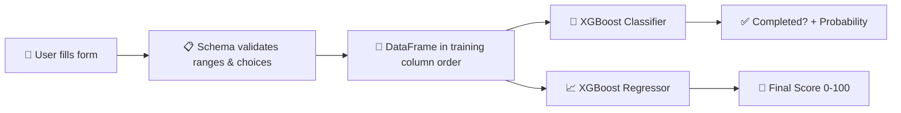

<!-- Animated header -->
<div align="center">


<!-- Typing animation -->
<a href="https://git.io/typing-svg">
  
</a>

<br/>

<!-- Badges -->


<br/><br/>

<!-- Link buttons -->
<a href="https://smart-outcome-predictor-mp2ss4dhafg96wgybmzxag.streamlit.app/">
  
</a>
<a href="https://github.com/mahesh-aiml/Smart-Outcome-Predictor/tree/main">
  
</a>
<a href="https://github.com/mahesh-aiml/Smart-Outcome-Predictor/blob/main/app.py">
  
</a>

</div>

---

## ✨ Overview

**Smart Outcome Predictor** ek interactive web app hai jo student aur course ki details leke do cheezein predict karta hai:

| 🎯 Task | 🧠 Type | 📤 Output |
|---|---|---|
| **Course Completion** | Classification | Completed / Not completed + probability (%) |
| **Final Score** | Regression | Predicted score (0 – 100) |

Dono models **XGBoost** se train kiye gaye hain aur `joblib` (`.pkl`) files ke roop me save hain. UI **Streamlit** me bani hai.

---

## 🎬 Features

- 🧾 **Dynamic form** – input fields `outputs/input_schema.json` se auto-generate hoti hain
- 🔢 **Smart limits** – numeric fields training-data ke min/max range me rehti hain
- 🏷️ **Categorical dropdowns** – sirf wahi values jo training me use hui
- 📈 **Completion probability** – sirf yes/no nahi, confidence bhi
- 🛟 **Self-healing** – agar `xgboost` missing ho to app khud install kar leta hai, aur schema missing ho to built-in default se rebuild kar leta hai
- ⚡ **Fast** – models aur schema `st.cache_resource` / `st.cache_data` se cache hote hain

---

## 🧩 Input Features

<details>
<summary><b>👤 Student & Course details (click to expand)</b></summary>

<br/>

**Numeric**

| Feature | Min | Max | Default |
|---|---|---|---|
| `age` | 16 | 45 | 24 |
| `week_of_year` | 1 | 52 | 27 |
| `sessions` | 1 | 94 | 17 |
| `time_spent_hours` | 0.6 | 76.8 | 16.1 |
| `videos_watched` | 0 | 158 | 23 |
| `quiz_attempts` | 0 | 20 | 7 |
| `assignments_submitted` | 0 | 12 | 4 |
| `forum_posts` | 0 | 8 | 1 |
| `avg_quiz_score` | 0 | 100 | 66.8 |
| `attendance_rate` | 0.404 | 1.0 | 0.855 |
| `couse_durection_day` | 0 | 364 | 180 |

**Categorical**

| Feature | Choices |
|---|---|
| `country_region` | Africa, Americas, Asia, Europe, Oceania |
| `device_type` | Laptop, Mobile, Tablet |
| `education_background` | Graduate, HighSchool, Undergrad, WorkingPro |
| `course_level` | Advanced, Beginner, Intermediate |
| `course_category` | Business, Data, Design, Marketing, Programming |

</details>

---

## 🚀 Quick Start

### 1️⃣ Clone the repository

```bash
git clone https://github.com/mahesh-aiml/Smart-Outcome-Predictor.git
cd Smart-Outcome-Predictor
```

### 2️⃣ (Optional) Virtual environment banao

```bash
python -m venv venv

# Windows
venv\Scripts\activate

# macOS / Linux
source venv/bin/activate
```

### 3️⃣ Dependencies install karo

```bash
pip install -r requirements.txt
```

### 4️⃣ App run karo

```bash
streamlit run app.py
```

App browser me `http://localhost:8501` par khul jayegi. 🎉

> 🌐 Live demo: [Smart Outcome Predictor · Streamlit](https://smart-outcome-predictor-mp2ss4dhafg96wgybmzxag.streamlit.app/)
>
> 📄 Source code: [`app.py`](https://github.com/mahesh-aiml/Smart-Outcome-Predictor/blob/main/app.py)

---

## 📁 Project Structure

```text
Smart-Outcome-Predictor/
├── app.py                              # Streamlit application
├── requirements.txt                    # Python dependencies
├── .gitignore
├── model/
│   ├── best_classifiction_model.pkl    # Course completion model
│   └── best_regression_model.pkl       # Final score model
└── outputs/
    └── input_schema.json               # Feature names, types, ranges, choices
```

---

## 🔄 How It Works



---

## 🛠️ Tech Stack

<div align="center">


</div>

`Streamlit` · `XGBoost` · `scikit-learn` · `pandas` · `NumPy` · `joblib` · `matplotlib` · `seaborn` · `openpyxl`

---

## ⚠️ Troubleshooting

| Problem | Solution |
|---|---|
| `Model file not found` | Project zip ko dobara extract karo taaki `model/` folder aaye |
| `xgboost` import error | `python -m pip install xgboost` chalao aur app restart karo |
| `Prediction failed` | Check karo ki `input_schema.json` ke columns training ke features se match karte hain |

---

## 📌 Disclaimer

> These are **model estimates, not guarantees**. Predictions ko educator ke judgment ke saath **decision-support** ki tarah use karo.

---

<div align="center">

### 💜 Mahesh Lohar

⭐ **Agar project pasand aaya to repo ko star zaroor karo!** ⭐


</div>
